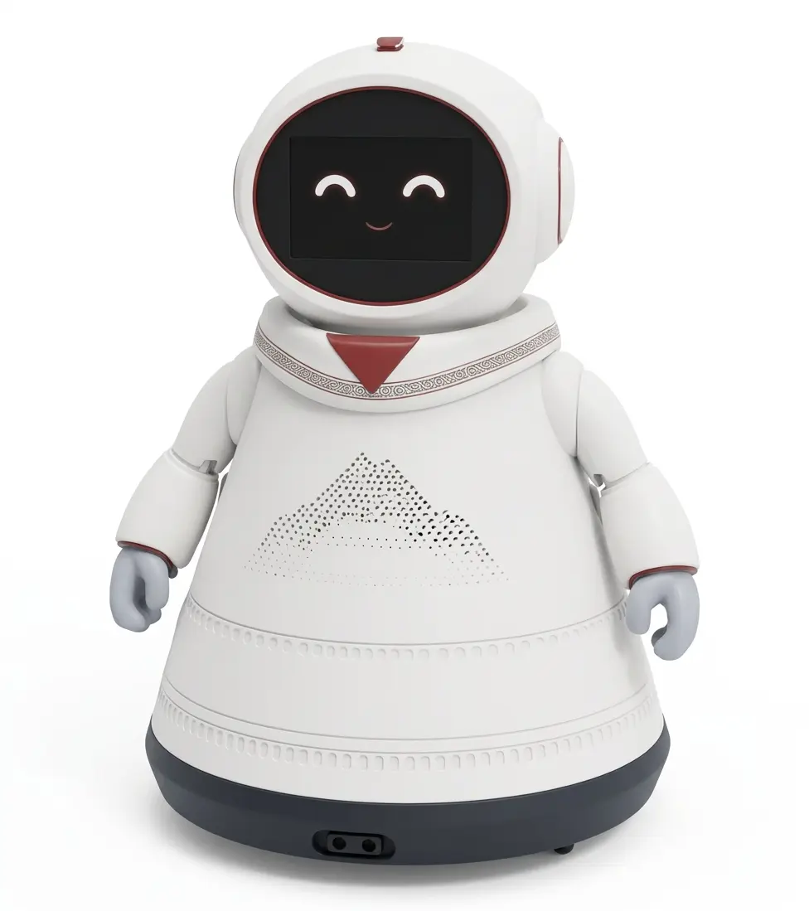

# ROMEO — Socially Friendly Robot

<p align="center">
  
</p>

**ROMEO** es un robot social amigable (*socially friendly robot*) y socialmente asistivo (SAR, *Socially Assistive Robot*), orientado a la **interacción humano-robot (HRI)** con **niños y jóvenes con TDAH** (Trastorno por Déficit de Atención e Hiperactividad) **y TEA** (Trastorno del Espectro Autista), entre otras necesidades de apoyo.

Su objetivo es ofrecer una interacción predecible, breve y motivadora: conversa (**Chat libre**) y juega **Trivia** por voz o texto, con una carita animada que expresa emociones, música, movimiento sobre un carrito mecanum y un juego de reconocimiento e imitación de emociones por cámara que ayuda a practicar la identificación de expresiones faciales.

Este repositorio contiene la versión **ROS 2** del robot: 4 paquetes que reemplazan al proceso Python monolítico original ([`Arquitecture-Agentic-RAG/deploy-raspberry-standalone/`](https://github.com/Adr4563/Arquitecture-Agentic-RAG)). La documentación técnica del workspace (nodos, tópicos, configuración, compilación y ejecución) está en **[`ros2_ws/README.md`](ros2_ws/README.md)**.

---

## Contenido

- [Qué hace ROMEO](#qué-hace-romeo)
- [Hardware](#hardware)
- [Modelos de lenguaje (Ollama)](#modelos-de-lenguaje-ollama)
- [Voz](#voz)
- [Datos](#datos)
- [Estructura del repositorio](#estructura-del-repositorio)
- [Inicio rápido](#inicio-rápido)

> **Revisión pendiente:** hay dos problemas abiertos de audio documentados en
> [`docs/REVISION-PENDIENTE.md`](docs/REVISION-PENDIENTE.md) — la placa se
> desconecta del USB (65 veces, cada 1-2 s) y el robot se transcribe a sí
> mismo. El plan de la siguiente iteración está en
> [`docs/arquitectura-v2.md`](docs/arquitectura-v2.md).

---

## Qué hace ROMEO

| Modo | Qué ocurre |
|---|---|
| **Chat libre** | Conversa de forma abierta con gemma3:4b y recuerda los últimos turnos. Adapta el tono al ánimo de Romeo, que sigue al de la persona. |
| **Trivia** | Empieza al decir «trivia» y encadena preguntas al azar de un banco de 185 (sin las de canciones ni las del juego de caras) hasta que la persona pide parar. Una IA decide si acertó y comenta como una persona, con un tono que cambia según el ánimo de Romeo. |
| **Juego de emociones** | Pide al usuario que imite una expresión ("¡Hazme una cara de feliz!"), la reconoce con la cámara y le dice si acertó. |

En cada reacción, ROMEO sigue siempre el mismo **orden**: primero habla y después cambia de cara. Esa secuencia fija hace que la interacción sea predecible. El único movimiento del carrito lo decide la capa afectiva (AEB).

Si falta algún componente (cámara, carrito, pantalla), el robot sigue conversando con lo que tenga disponible.

---

## Hardware

| Componente | Detalle | Conexión |
|---|---|---|
| **Computador principal** | Raspberry Pi 4, 8 GB de RAM, sin GPU (ARM Cortex-A72) | — |
| **PC de inferencia** | PC con Windows 10 Pro, 8 GB de RAM, sin GPU | Red local; ejecuta el LLM, STT, TTS, SER y TER |
| **Motores** | Carrito mecanum de 4 ruedas, 2 drivers L298N, controlado por un **ESP32-S3 DevKitC-1** | Serial/USB a 115200 baudios (`/dev/ttyACM0` por defecto) |
| **Cámara** | Raspberry Pi AI Camera (Sony IMX500) | `picamera2` |
| **Pantalla** | MPI5008, 5 pulgadas, 800 × 480, HDMI, sin sesión gráfica (headless) | `mpv --vo=drm` |
| **Audio** | Waveshare ESP32-S3-AUDIO-Board (micrófonos y altavoz) | USB Audio Class 2.0 |

### Protocolo de motores

El firmware del ESP32-S3 vive en [`firmware-esp32-s3/`](firmware-esp32-s3/README.md). Recibe un comando de texto por línea:

| Comando | Movimiento |
|---|---|
| `F` / `B` | Adelante / atrás |
| `SL` / `SR` | Desplazamiento lateral (strafe) sin rotar el chasis |
| `RL` / `RR` | Rotar sobre su propio eje |
| `FL` / `FR` / `BL` / `BR` | Diagonales |
| `S` | Detenerse (también cualquier texto no reconocido) |
| `T1`..`T4` | Diagnóstico: mueven una sola rueda, para aislar cableado. No los usa ROS |
| `ROTATE360` | No existe en el firmware: `moving_control_node` lo convierte en 6 pulsos de `RR` con 0.4 s de pausa |

El firmware tiene un **watchdog**: si no llega otro comando en 500 ms, detiene los motores solo. Así se protege ante un cable desconectado o un proceso colgado en la Pi.

### Cámara y emociones

La lectura facial (FER) corre con dos modelos ONNX preentrenados:

- `face_detection_yunet_2023mar.onnx` (~230 KB): detector de caras YuNet. Corre en la **CPU**. También hay una versión para el acelerador del IMX500 (`imx500_network_yunet.rpk`), que se usa si la Pi tiene permiso de lectura en `/sys/kernel/debug`.
- `emotion-ferplus-8.onnx` (~35 MB): clasificador FER+. Sus 8 clases se agrupan en las 4 del robot: felicidad, tristeza, enojo y neutral.

La cámara queda abierta, pero YuNet y FER+ solo trabajan **mientras alguien habla** (5 cuadros por segundo a 320 × 240): `communication_node` avisa por `/romeo/voz_detectada`. El juego de caras la activa por su cuenta. Con `fer_bajo_demanda: false` clasifica todo el tiempo.

En el juego de caras, si el modo continuo no está activo, se hacen hasta 15 intentos de captura y detección, con 0.2 s entre intentos. Es obligatorio llamar a `picam2.stop()` **y** a `picam2.close()`: sin el `close()`, el siguiente `Picamera2()` del mismo proceso no puede adquirir la cámara.

### Pantalla

Un único proceso `mpv --idle` queda vivo toda la sesión, y cambiar de cara es un comando `loadfile` enviado por su socket IPC. Las caras son `.mp4` H.264 en lugar de `.gif` porque mpv las decodifica por hardware (`v4l2m2m`): usan ~10-23 % de CPU, frente a ~100-137 % con GIF.

Caras disponibles: `happy`, `sad`, `angry`, `content`, `speaking` y `countdown`.

El backend se elige automáticamente: **Linux sin `$DISPLAY` → DRM (mpv)**. En cualquier otro caso (Windows, o Linux con escritorio) se usa **Tkinter** (`face_viewer.py`), pensado para demos en PC.

---

## Modelos de lenguaje (Ollama)

Ollama corre **en la PC**, no en la Pi, y se usa su API compatible con OpenAI (`/v1/chat/completions`). Un solo modelo hace todo: **`gemma3:4b`**, sin fine-tuning, descargado con `ollama pull`.

| Variable de entorno | Valor al lanzar | Rol |
|---|---|---|
| `CHAT_MODEL` | `gemma3:4b` | Respuestas del Chat libre |
| `TRIVIA_CORRECTOR_MODEL` | `gemma3:4b` | Veredicto y comentario de la Trivia |

- **Chat libre:** temperatura 0.7, hasta 3 frases (4 si piden un consejo) y memoria de los últimos 3 turnos. El *system prompt* se arma en `agente_chat.py` con la base, el trato (sin apodos y neutro de género) y el tono del AEB.
- **Casos graves** (`seguridad.py`): si la persona habla de hacerse daño, de que la lastiman o de lastimar a alguien, la instrucción reemplaza al tono. Romeo escucha y pide hablar con alguien de confianza.
- **Trivia** (`agente_trivia.juzgar`): dos llamadas. La primera, con temperatura 0.0, contesta solo SI o NO. La segunda, con 0.7, escribe el comentario; un dato curioso sale el 30 % de las veces.
- **Enrutado sin LLM:** `orchestrator_node.enrutar()` usa una expresión regular. Va a Trivia solo si el mensaje nombra la trivia o el juego de caras; todo lo demás es Chat libre.
- **Salir de la Trivia sin LLM:** se buscan las frases de `frases.SALIR_TRIVIA` y `frases.TEMA_PERSONAL`.
- Si el LLM no responde, el chat lo avisa y sigue vivo, y la trivia usa frases de respaldo.

---

## Voz

### Salida (lo que dice ROMEO)

El TTS corre en la PC (`tts_server.py`, puerto 8083): **Piper VITS, voz `es_MX-claude-high`**, con sherpa-onnx. La Pi pide el audio y lo reproduce en la placa de audio. `voz_motor` admite `vits` (por defecto) y `piper`. ROMEO espera a terminar de hablar antes de continuar con el turno.

### Entrada (lo que dice el usuario)

El micrófono es el de la placa de audio. La Pi detecta el inicio y el fin de cada frase con **Silero VAD** y manda el audio a la PC (`stt_server.py`, puerto 8082), que devuelve:

- el texto, con **NVIDIA FastConformer en español** (`ROMEO_STT_MOTOR=nemo`; `whisper` es la alternativa);
- la emoción de la voz (**SER**, wav2vec2 MESD);
- la emoción del texto (**TER**, RoBERTuito).

Mientras Romeo suena, el audio que entra se descarta para que no se transcriba a sí mismo. Si llega una frase mientras sigue el turno anterior, también se descarta.

---

## Datos

- **Preguntas de Trivia:** `romeo_brain/data/preguntas.jsonl`, con 211 filas: 200 tienen respuesta esperada y 5 de ellas son de canciones, que la trivia ya no usa. Se cargan en memoria al iniciar. Cada fila tiene esta forma:
  ```json
  {"id": 1, "pregunta": "...", "cara": "Neutral",
   "respuesta_esperada": "...", "tema": "Arte, música y cultura - Nivel 1",
   "cara_respuesta_buena": "Neutral", "cara_respuesta_mala": "Neutral",
   "musical": "", "desplazamiento": "Adelante"}
  ```
  `desplazamiento` admite `Adelante`, `Atrás`, `Izquierda`, `Derecha` y `Girar 360°`. Hay 13 preguntas duplicadas por texto (con `id` distinto) que siguen sin resolverse.
- **Personalidad:** el trato de ROMEO lo definen los prompts de `agente_chat.py`; `gemma3:4b` no trae personalidad entrenada.
- **Música:** `romeo_drivers/data/musica/` contiene `angry-birds`, `danza-kuduro`, `minecraft`, `more-than-words-heaven`, `plantas-vs-zombies`, `super-mario-bros` y `zelda` (mp3). La trivia ya no usa las preguntas de canciones.

---

## Estructura del repositorio

```
Socially-Friendly-Robot-Romeo-Astro/
├── README.md              este archivo: qué es ARFORD, hardware, IA y datos
├── ros2_ws/               workspace ROS 2 (el software del robot)
│   ├── README.md          documentación técnica del workspace
│   └── src/
│       ├── romeo_interfaces/   mensajes y servicios
│       ├── romeo_drivers/      nodos de hardware: voz, cámara y pantalla, motores
│       ├── romeo_brain/        el cerebro: máquina de estados de la conversación
│       └── romeo_bringup/      launch y parámetros
├── pruebas/
│   ├── web/               simulación de un turno completo en la PC, sin la Pi
│   └── panel_robot/       panel en vivo del robot: resultados, cálculo VAD y carrito
├── modelos/               modelos de IA (Git LFS) y su instalador
├── firmware-audio-board/  firmware de la placa de audio ESP32-S3
│   ├── README.md          documentación del firmware
│   └── main/              el código (C, ESP-IDF)
└── firmware-esp32-s3/     firmware del carrito ESP32-S3-DevKitC-1
    ├── README.md          documentación del firmware
    └── mecanum_car_esp32s3.ino  el código (Arduino)
```

La **placa de audio** es una Waveshare ESP32-S3-AUDIO-Board que aporta los micrófonos y el altavoz que a la Raspberry Pi le faltan. Su firmware la expone como **tarjeta de sonido USB**, de modo que la Pi la usa como un dispositivo de audio normal. Ver [`firmware-audio-board/README.md`](firmware-audio-board/README.md).

El **carrito mecanum** lo controla un ESP32-S3-DevKitC-1 que traduce comandos de texto a señales para dos drivers L298N. No decide nada: toda la lógica de movimiento está en `moving_control_node`. Ver [`firmware-esp32-s3/README.md`](firmware-esp32-s3/README.md).

---

## Inicio rápido

Requisitos: la Raspberry Pi del robot corre **Ubuntu 26.04 con ROS 2 Lyrical**, con `mpv`. La PC corre **Ollama con `gemma3:4b`** y los servidores `stt_server.py` y `tts_server.py`; la Pi los encuentra con la variable `ROMEO_PC`.

```bash
cd ros2_ws
pip install -r src/romeo_drivers/requirements.txt -r src/romeo_brain/requirements.txt
colcon build --symlink-install
source install/setup.bash
ros2 launch romeo_bringup romeo_bringup.launch.py
```

Para ver los resultados en vivo, corre `python3 pruebas/panel_robot/panel.py` en la Pi (lee el log de `ros2 launch`, por defecto `~/romeo_run.log`) y abre `http://<ip-de-la-pi>:8090/`.

Los pasos completos, las opciones de configuración y cómo comprobar que todo funciona están en [`ros2_ws/README.md`](ros2_ws/README.md#instalación-y-ejecución).
